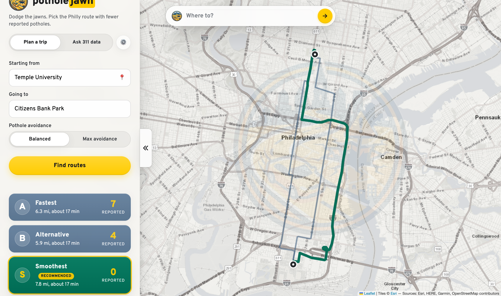
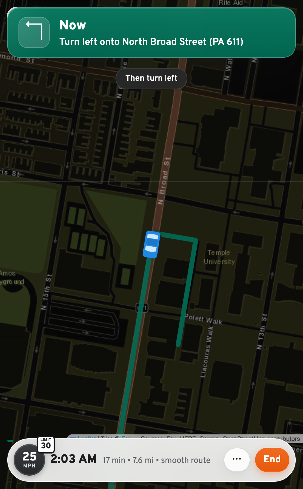

<div align="center">


# potholejawn

**A pothole-aware router for Philadelphia: live 311 data, our own street graph, and an AI agent that explains the pick.**

[](tests)
[](pyproject.toml)
[](LICENSE)
[](https://potholejawn.com)


*Every yellow dot is an open 311 pothole report, live from the city — 1,500+ in view before you type anything.*

</div>

Type where you are and where you are going in Philadelphia. The app fetches the
fastest driving routes, then **re-plans the drive on its own street graph with
every open 311 pothole report as a time penalty**, verifies each route against
the city's live data, and recommends one. An AI agent runs the tools and writes
the briefing; a plain-Python planner produces the same result when it cannot.
Then tap **Start navigation**: the map follows your position with a maneuver
banner, voice guidance, a speedometer with the posted limit, a heads-up for
every reported pothole ahead, alternative routes from wherever you are, and an
automatic smooth re-route when you leave the route. Pick your car and its
colour, your voice, miles or kilometres, and a night map. Every route also has
turn-by-turn directions and a one-tap hand-off to Google Maps that carries the
smooth route's waypoints.

Built in Philadelphia by David Pugliese. Open source under the MIT license.

## Try it

Live at **[potholejawn.com](https://potholejawn.com)** (also [potholejawn.app](https://potholejawn.app)) — installable to a phone home screen as a PWA.

- The map opens on **every open pothole report in Philly right now**, plotted citywide and clickable.
- Type a destination into the **"Where to?" pill** and go. Trips start from your location, like Google Maps; tap **Change** next to "From" to start somewhere else. Try `Citizens Bank Park` from `Temple University`: real result from live data (Oct 2026), the fastest route passes 7 open pothole reports; the smooth route passes 0, in the same 17 minutes.
- Save **Home**, **Work**, and favourites: they appear as chips under the trip form, at the top of every search list, and recent trips are one tap away in the "Where to?" pill. Everything stays on your device.
- Pick **Balanced** or **Max avoidance** to say how much time a pothole is worth to you, then **Start navigation** (or **Preview drive** at a desk), **Drive this in Google Maps**, or copy a share link (`/?to=…&avoid=strong`, with `from=` only when you chose a start).
- Or barely type: the search **autocompletes real Philly places** (Liberty Bell, Reading Terminal, the Pennovation Center — where this was built), and 📍 routes from your actual location.
- After a trip, open **"How this route was chosen"** to see every lookup behind the pick.

## Under the hood

Two agents, one shared hand-rolled tool-calling loop on the Anthropic API (no
framework). The model chooses which tools to call and in what order; tool
errors are fed back so it self-corrects; a 12-step limit and a full JSONL audit
trail per run keep it bounded and inspectable.

**Trip agent** — geocodes both endpoints, pulls the fastest route plus
alternatives from OSRM, asks the **smooth router** for a pothole-aware route,
runs a PostGIS query against the city's live 311 API for open "Street Defect"
reports within 30 m of every route, weighs pothole count, report age, and drive
time, and recommends one with a plain-language briefing. Agent steps stream to
the panel live over Server-Sent Events, so you watch it think instead of
staring at a spinner.

**311 data questions (terminal only)** — `python -m pothole_agent.cli` answers
open-ended questions by writing and running guarded SQL against the full
5.9M-row dataset, reading its own errors and retrying. It shares the trip
agent's tool loop and is kept as a developer and research tool; it is not part
of the app's UI.

**Map-first UI** — full-viewport map with a floating "Where to?" search pill, a
slide-in results panel on desktop and a bottom sheet on mobile, a citywide layer
of every open pothole report, route signs (A/B with
report counts), the brand emblem as a map watermark, and PWA install support.

## Screenshots

| Desktop — trip result | Mobile — live navigation |
|---|---|
|  |  |

## Why

Philadelphia publishes every 311 request since 2014 (about 6 million rows), but
answering a real question takes SQL skills and knowledge of the data's quirks.
In 2026 the city closes illegal-dumping reports in about 4 days, while roughly
19% of pothole reports and 81% of abandoned-vehicle reports are still open.
Residents, journalists, and council staff should be able to find that out by asking.

## How it works

```
        map-first UI (Leaflet + Flask)              pothole_agent/webapp.py, static/
        citywide pothole layer · "Where to?" pill · autocomplete · avoidance switch
                |
"Temple University" -> "Citizens Bank Park"
        |
   trip agent (Claude + tools)                      pothole_agent/trip.py
        +-- geocode_address     US Census geocoder, OpenStreetMap fallback
        +-- find_routes         OSRM: fastest route plus alternatives (A, B, ...)
        +-- find_smooth_route   our router (route S), see below
        +-- scan_route          PostGIS query on the city's 311 API: open
        |                       'Street Defect' reports within 30 m of the route
        +-- recommend_route     records the choice as structured output
        |
   agent steps stream back live (SSE) -> slide-in panel / bottom sheet
        route signs · comparison · briefing · directions · Google Maps hand-off
```

### The smooth router (`pothole_agent/streetgraph.py`, `smooth.py`)

Time-optimal routers like OSRM cannot avoid potholes; the best they can do is
offer alternatives. So potholejawn routes on its own copy of the city's streets:

1. **Street graph.** The drivable network for Philadelphia comes from
   OpenStreetMap (Overpass) and is compacted to a 3 MB gzipped JSON file in
   `data/` (64k intersections, 93k segments, one-way streets and posted speeds
   kept). It loads in a quarter of a second and ships inside the container.
2. **Penalties from live data.** Every open Street Defect report from the last
   12 months (about 1,500) is matched to the street segments within 30 m of it
   and becomes a time penalty: 45 s per report on *Balanced*, 180 s on *Max
   avoidance*, weighted down as reports age (a year-old ticket may already be
   patched). The set refreshes every 10 minutes.
3. **Search.** A* over travel time plus penalties, with turn-aware junction
   costs calibrated against OSRM on real Philly trips (within about 10%).
4. **Make it legal.** The graph path is snapped through OSRM via a handful of
   waypoints with bearings, which yields a route that respects turn
   restrictions, with real durations and turn-by-turn directions. If OSRM
   wanders or is down, the graph geometry is used as is.
5. **Verify.** The smooth route is scanned with the exact same 311 corridor
   query as every other route, so its count is the city's number, not ours.

The deterministic pick (used when the agent is unavailable, and suggested to
it) scores each route as minutes plus the same time value per report the router
optimised with, so the recommendation agrees with the plan.

### Live navigation (`static/app.js`, `/api/navigate`)

Navigation runs in the browser against the route's own geometry: each GPS fix
is snapped to the polyline, the next maneuver (OSRM's maneuver locations)
drives the banner and the voice prompt, and every reported pothole on the
route is announced when it is within 160 m ahead. Two consecutive fixes more
than 45 m off the line trigger a re-route: `/api/navigate` runs the smooth
router from the current position (no model call, about a second) and the new
route takes over without leaving navigation. The screen stays awake via the
Wake Lock API where supported. "Preview drive" replays the route through the
same code path, which is how the flow is tested without a car.

Navigation chrome, in the spirit of Google Maps and Waze:

- **Speedometer** from GPS speed, with the **posted limit** read from the
  street graph's OpenStreetMap `maxspeed` tags via `/api/road` (polled every
  few seconds, answered from memory). The dial turns red when you are over.
- **Alternative routes from here**: the menu asks `/api/navigate?alternatives=1`
  for the smooth route, the max-avoidance route, and OSRM's fastest route and
  alternative from your current position, each scanned, and switches on tap.
- **Your vehicle**: seven top-down icons (car, SUV, pickup, taxi, bus,
  motorcycle, bicycle) in eight colours, remembered on the device.
- **Voice**: any English voice the device offers, with a speed slider and a
  test button; haptic nudges before each turn on phones that vibrate.
- **Night map** from sunset to sunrise (or forced), re-center after panning,
  route overview, a trip progress bar, and **Report a pothole here**, which
  drops a pin at your position to file with 311 after the drive.

The analyst agent (`pothole_agent/agent.py`, `tools.py`) uses `get_schema`,
`list_categories`, and `run_sql`. When a query fails, the error goes back to the
model, which fixes the SQL and retries.

## Reliability and safety

- **Graceful degradation**: if the API key is missing or the model call fails,
  a plain-Python planner produces the same map and a simpler briefing. If the
  agent skips a route, `ensure_complete` scans it anyway. The demo never dies.
- **The model never writes the route SQL.** It is built in `routing.py` from
  validated numbers only, and the search radius is clamped to 10 to 100 m.
- **Geofence**: every coordinate must fall inside a Philadelphia bounding box.
- **Browser safety**: API data is inserted with `textContent`, never parsed as
  HTML; CDN assets are pinned with Subresource Integrity hashes.
- **Rate limiting**: per-IP and global rate limits on the public deployment's
  agent endpoints.
- **Cost engineering**: Anthropic prompt caching on the agent loop (later steps
  read the prompt prefix from cache at ~10% price) plus a one-hour trip-result
  cache for repeated routes.
- **Honest framing**: markers are resident reports, not verified potholes, and
  the UI says so.
- **Read-only SQL guardrail** (`pothole_agent/guardrails.py`): the model's SQL is
  treated as untrusted input. Single SELECT only, table allowlist, no comments,
  no admin functions, results capped at 200 rows.
- **Step limit**: a run stops after 12 model turns, so it cannot loop forever.
- **Full audit trail**: every thought, tool call, SQL query, error, and token
  count is written to `runs/run-<timestamp>.jsonl`.
- **Honest analysis rules**: the agent reports the open-case share next to any
  time-to-close figure, and does not confuse "more reports" with "more potholes".
- **Tests** run with a fake model client and a synthetic street grid, so no API
  key or network is needed.

## Setup

```bash
python3 -m venv .venv && source .venv/bin/activate
pip install -r requirements.txt
cp .env.example .env          # then add your ANTHROPIC_API_KEY
```

## Run

```bash
python -m pothole_agent.webapp                    # map UI at http://127.0.0.1:5000
python -m pothole_agent.cli                       # 311 data question from the terminal
python -m pothole_agent.cli "Which zip codes wait longest for abandoned car removal?"
python -m pothole_agent.streetgraph build         # refresh the street graph from OpenStreetMap
```

## Deploy

Runs entirely on Google Cloud: Cloud Run, Artifact Registry, Cloud Build,
Secret Manager, Cloud Logging. See [docs/deploy.md](docs/deploy.md); the
short version is `gcloud builds submit --config cloudbuild.yaml .`

## Test

```bash
pytest -q
```

## Origins

potholejawn started as a one-day build at a Philadelphia hackathon in
September 2026 (the pitch and demo script from that day are in
`docs/hackathon/`). It has since grown into the pothole-aware router and
navigation app described above.

## Data sources

[OpenDataPhilly 311 Service and Information Requests](https://opendataphilly.org/datasets/311-service-and-information-requests/),
queried live through the city's public Carto SQL API. No API key is required for the data.
Street network: OpenStreetMap contributors (ODbL), via Overpass. Geocoding: US Census
Geocoder and OpenStreetMap Nominatim. Fast routes and snapping: the public OSRM demo
server. Map tiles: Esri World Street Map.

## Tools used

Python 3.12, Anthropic API (Claude, tool use), Flask, Leaflet, PostGIS via the City of
Philadelphia Carto SQL API, OSRM, US Census Geocoder, Nominatim, pytest.

## License

MIT
